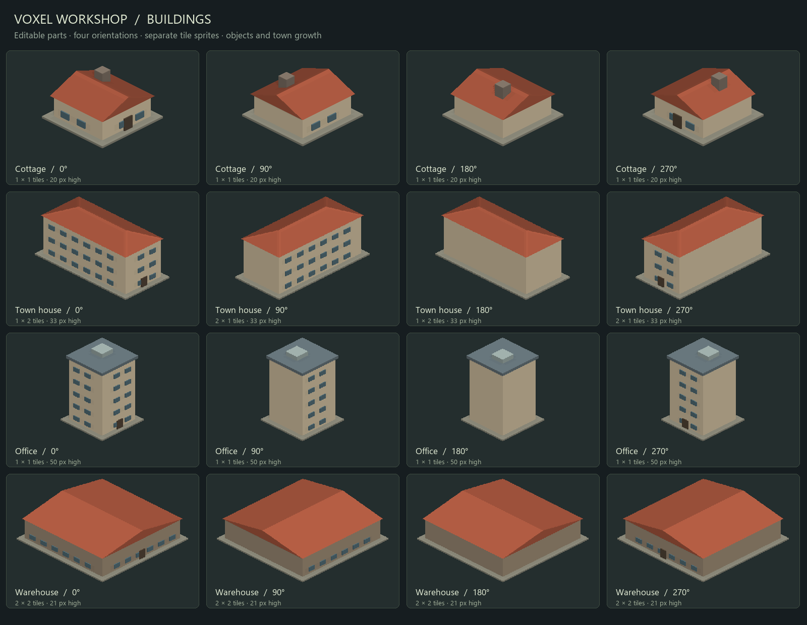
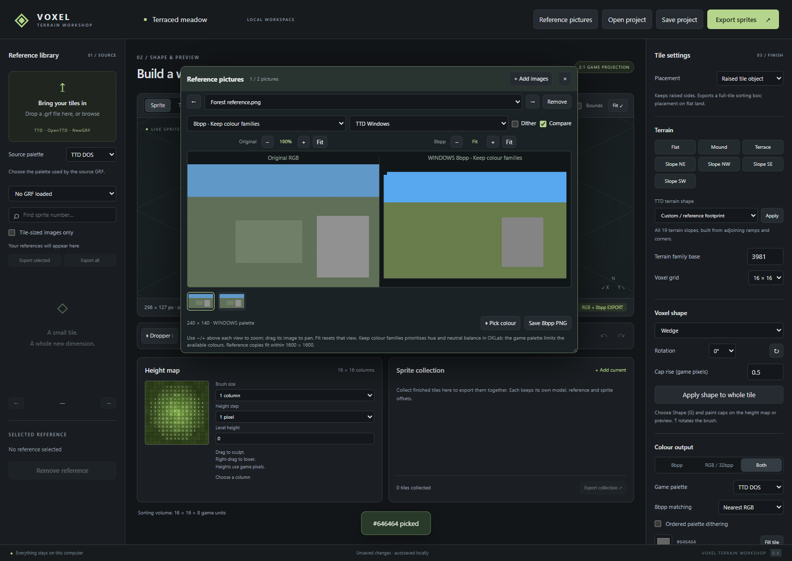

# TTD Voxels to Pixels Renderer

A local, browser-based workshop for creating **OpenTTD/TTD-style terrain and building sprites**. Sculpt shaped voxel columns, assemble buildings from solid parts, use NewGRF sprites or screenshots as references, and export **each sprite as a separate PNG** with its bounds and offsets.

The application interface is currently labelled **Voxel Terrain Workshop**. It runs a Python backend on your computer and opens in your normal browser. It does not need a cloud account, a Node build, or an internet connection after setup.



## What you can do

| Feature | Available tools |
| --- | --- |
| Terrain | 8×8, 16×16 and 32×32 grids; cube, wedge, diagonal, corner, inner corner, ridge, valley and pyramid caps; all 19 native TTD terrain slopes. |
| Buildings | Editable walls, floors, roofs, windows and details; raised parts and overhangs inside the lot; four orientations; lots up to 2×2 tiles. |
| Game placement | Ground-sprite replacements, decorative NewObjects, and growing town houses with population, passenger/mail settings and construction stages. |
| GRF references | Import TTD/OpenTTD GRFs through GRFCodec; browse zoom/depth variants; extract original reference sprites as individual PNGs. |
| Picture references | Optional movable/resizable window holding up to 12 screenshots; cycle images; compare original and palette-converted versions; zoom and pan each pane independently. |
| Colour | DOS/Windows palettes, indexed 8bpp, RGB/32bpp or both; nearest-RGB or hue-preserving matching; optional dithering and explicit palette effects. |
| Lighting and textures | Adjustable sun, ambient light, shadows and ambient occlusion; optional projection of a GRF reference onto the model. |
| Exports | Separate sprite PNGs, indexed masks where needed, metadata, editable projects and NML/NFO; optional compiled test GRFs. |

## Standalone apps

Native app packages bundle Python, the rendering libraries, NML and GRFCodec while keeping the browser interface. Download an archive from [Releases](https://github.com/MnHebi/TTD-Voxels-to-Pixels-Renderer/releases), extract the **whole folder**, and run the included launcher or executable. No separate Python installation is needed for those packages.

Windows x64 and Linux x64 packages are accompanied by automated smoke reports. Apple Silicon and Intel macOS builds are **experimental, unsigned and not notarized**. We have no local Mac hardware, so hands-on Mac validation is left to the community. A hosted build passing is not a claim of full desktop compatibility.

See [app-package instructions](docs/APP_PACKAGES.md) for OS-specific launchers, data locations, build commands and testing scope. The following setup instructions are for running the **source version**.

## Requirements

A browser alone is not sufficient: the local Python process must remain running while you use the editor.

| Component | Purpose |
| --- | --- |
| Python **3.10 or newer** | Required to run the local backend. |
| Pillow and NumPy | Required for image processing and software rendering; installed by `requirements.txt`. |
| NML | Compiles modern test NewGRFs; included in `requirements.txt`. Editing and PNG export also work without it. |
| [GRFCodec](https://www.openttd.org/downloads/grfcodec-releases/latest) | Separate, optional executable for importing GRFs and compiling legacy ground replacements. |
| Current browser | Canvas, Pointer Events and IndexedDB support. |

The current validation was performed on **Windows**. The Python/browser architecture is intended to remain portable; Linux and macOS installation commands are provided below, but those platforms have not yet been fully validated. Native packages are built by the Standalone apps workflow; macOS packages are experimental and need community validation. See [app-package instructions](docs/APP_PACKAGES.md).

## Install and start

Download this repository using **Code → Download ZIP** and extract it, or clone it:

```sh
git clone https://github.com/MnHebi/TTD-Voxels-to-Pixels-Renderer.git
cd TTD-Voxels-to-Pixels-Renderer
```

Run the following commands from the extracted/cloned project directory.

### Windows

Install Python 3.10+ if needed, then use PowerShell:

```powershell
py -3 -m venv .venv
.\.venv\Scripts\python.exe -m pip install -r requirements.txt
.\.venv\Scripts\python.exe app.py
```

After the first setup, you can double-click **Start Workshop.cmd**. It looks for the project's virtual environment and other available Python runtimes. To select an interpreter explicitly, set `WORKSHOP_PYTHON` to its executable path.

### Linux / macOS

With Python 3.10+ installed:

```sh
python3 -m venv .venv
./.venv/bin/python -m pip install -r requirements.txt
./.venv/bin/python app.py
```

The launcher opens **http://127.0.0.1:7865/**. Keep its terminal open; press **Ctrl+C** to stop the application. If the browser does not open automatically, visit that address yourself.

You can pass `--no-browser` to `app.py` to suppress automatic opening, or `--port 7866` to choose another port. The server binds to loopback only. Browser autosave belongs to that browser profile and local address, so use **Save project** when moving between computers or changing your setup.

### Enable GRF import

Install GRFCodec separately, then record its executable path. For example, on Windows:

```powershell
.\.venv\Scripts\python.exe tools/configure.py --grfcodec "C:\Tools\grfcodec\grfcodec.exe"
```

On Linux/macOS use `.venv/bin/python` and the path to the appropriate GRFCodec executable. Alternatively, put `grfcodec` on `PATH` or set the `GRFCODEC` environment variable. Configuration is saved to the ignored `local.json`; restart the application after changing it. Game artwork and GRFCodec binaries are not included in this repository.

## Make your first terrain sprite

1. Select **Placement → Ground tile** for a terrain replacement, or **Raised tile object** for a decorative terrain object.
2. Choose a grid size and a terrain preset. **TTD terrain shape → Apply** constructs any of the 19 native slope shapes. For custom caps, select a shape, rotation and rise, then paint with the Shape tool.
3. Sculpt in the height map or isometric preview. Set colour, lighting and output mode. **Tiling** checks how opposite edges join; **Bounds** shows the sprite origin and extents.
4. Optionally import a GRF (its declared DOS/Windows palette is detected automatically; override **Source palette** if needed), select a sprite reference, then choose a texture-mapping mode. Start with **Reference only** if you only need visual guidance.
5. Set the target sprite family/base ID for a ground replacement. The default grass family starts at **3981**, and native presets compute their own slope offsets. A sprite number from an arbitrary NewGRF is not automatically a base-game replacement ID.
6. Choose export zooms and click **Export sprites**. Use **Add current** to collect several models, then **Export collection** to export them together.

Ground models use the selected native slope silhouette, or a reference/flat footprint in custom mode. Export rejects missing ground pixels. The [detailed guide](docs/USER_GUIDE.md) explains cap geometry, grid resizing, slope ordering, projection and texture controls.

## Make a building

1. Select **Placement → Decorative building** or **Growing town house**.
2. Choose **Cottage**, **Town house**, **Office**, **Warehouse** or **Empty lot**, then **Create**.
3. Select a part in the sprite, plan or parts list. Adjust its position, dimensions, material and shape, then click **Apply part changes**. Add/duplicate/delete parts for walls, floors, balconies, windows, doors, chimneys and roof details.
4. Set the lot to **1×1, 1×2, 2×1 or 2×2 tiles**. Use **View ↻** to inspect orientations, and choose whether to export all four. Parts must remain inside the lot; building height is limited to 128 normal-zoom pixels.
5. For town houses, set population, mail generation, passenger/mail acceptance, growth weight and construction years. The four-stage construction preview shows the generated height-progress models.
6. Export. Decorative buildings become placeable NewObjects; town houses become additional town-growth types. Each enabled house orientation is a separate variation. Buildings currently require flat lots.

Building exports render/light the complete model before splitting visible pixels into tile/view/stage sprites. They use conservative per-tile sorting boxes with geometry-derived height. Objects export the finished model; houses include all four construction stages.

## Use screenshots and pick colours

Open **Reference pictures** in the top bar. Add multiple PNG, JPEG, WebP, BMP or GIF files, drag them into the window, or paste a clipboard image while it has focus. Cycle with arrows, thumbnails, the selector or Left/Right. Move the title bar and resize the corner as needed.

Choose **Original RGB**, **8bpp · Keep colour families** or **8bpp · Nearest RGB**, and a DOS/Windows palette. Enable **Compare** to see the original and conversion side by side. Each pane has independent **− / +** buttons, a **Fit** reset, and drag panning. **Save 8bpp PNG** downloads the selected palette conversion.

**Keep colour families** uses perceptual hue/lightness/chroma matching and optional ordered dithering to reduce unwanted shifts such as muted greens becoming yellow/brown. It keeps near-neutral colours neutral and avoids inventing palette effects. The fixed palette cannot reproduce every source colour; inspect the comparison for lightness/saturation tradeoffs. This mode is also available under **Colour output → 8bpp matching** for model exports. Existing projects retain nearest-RGB matching by default.

Click **Dropper** or press **I** to sample the model preview, a GRF library thumbnail, a Compare reference, or either picture pane. Transparent pixels are ignored. Optional effect preservation retains exact company-colour/animation indices when palettes match. For buildings, apply the picked colour with **Paint selected part** or **Apply part changes**.

Screenshot references are visual references and colour sources. They are not automatically aligned game textures or reconstructed 3D models. Reference copies fit within 1600×1600 pixels; see the [guide](docs/USER_GUIDE.md) for file, colour-profile and storage limits.



## Main shortcuts

| Key | Action |
| --- | --- |
| R / L | Raise / lower terrain. Right-drag also lowers. |
| P / F / G | Paint / set height / shape brush. |
| T | Rotate the shape brush. |
| I / Esc | Pixel dropper / cancel the dropper. |
| M | Sample the original voxel material and cap shape. |
| Ctrl+Z / Ctrl+Y | Undo / redo model edits. |
| Mouse wheel over the main preview | Zoom the model view. |
| Left / Right in the reference-picture window | Previous / next picture. |

## Save projects and export sprites

**Save project** writes an editable `.voxel.json` file containing the current model, collection, GRF reference pixels/masks and screenshot references with their viewer settings. **Open project** restores it. Browser autosave is a convenience; keep project-file backups. Imported GRF libraries are session-local and can be re-imported. Collection and screenshot additions/removals are independent of model Undo/Redo.

**Export sprites** produces a ZIP containing a folder of **individual PNGs, not a sprite sheet**:

- 8bpp indexed sprites, RGB/32bpp sprites, or both at the selected zooms.
- Separate indexed masks for 32bpp sprites with explicit palette effects.
- `manifest.json` with bounds, signed offsets, hashes, provenance and placement metadata.
- Editable model/collection data, NML source and supporting language files.
- A compiled `workshop.grf` and compiler-generated NFO when modern compilation is enabled; legacy exports include NFO source.

The 32bpp mode includes the normal-zoom 8bpp fallback required by the export pipeline. Unpacked exports also remain under `.work/exports/`. Screenshot references are saved with editable projects, but are not included in sprite-export bundles.

For game testing, extract the bundle, install `workshop.grf` in OpenTTD's NewGRF directory and enable it in **NewGRF Settings** before starting a new game. Decorative buildings appear in the Objects menu; town houses follow the game's town-growth rules. The generated project-dependent GRFID is intended for test builds. A published NewGRF needs a deliberately maintained GRFID/version in its source.

## Generate the example sets

On Windows, using the virtual environment created above:

```powershell
.\.venv\Scripts\python.exe tools/export_slopes.py --build
.\.venv\Scripts\python.exe tools/export_buildings.py --build
.\.venv\Scripts\python.exe tools/export_demo.py --build
```

On Linux/macOS use `.venv/bin/python`. These create reproducible, self-authored examples under `exports/`, including the complete 19-slope family and building presets. Omit `--build` to export PNGs and source without compiling a GRF. Generated archives and decoded third-party artwork are kept out of Git.

## Validation and current limits

Run the Python checks from the repository root:

```powershell
.\.venv\Scripts\python.exe -m unittest discover -s tests -v
```

Use `.venv/bin/python` on Linux/macOS. Compiler/decoder integration tests explicitly skip if the relevant optional tools are unavailable. Optional Playwright browser checks and their environment variables are described in the [detailed guide](docs/USER_GUIDE.md#validation).

The recorded validation includes **69 passing Python tests**, Windows standalone-package checks, browser workflows, exact PNG-to-compiled-GRF round trips, and isolated OpenTTD loading/saving checks. See [VALIDATION.md](VALIDATION.md) for the evidence and its scope. Successful compilation/loading does not establish in-game art approval, town-growth/cargo behaviour or visual sorting; those still need interactive review.

Terrain uses solid columns with shaped caps. Buildings use overlapping solid parts, including raised floors and overhangs within the lot. Arbitrary mesh/VOX import, a freely rotating camera and automatic reconstruction from 2D artwork are not implemented. Legacy export is restricted to normal-zoom 8bpp ground replacements for the TTD/TTDPatch pipeline; unpatched original TTD does not load NewGRFs.

## Licence and attribution

The application is licensed under **GNU GPL version 2 only (`GPL-2.0-only`)**. See [LICENSE](LICENSE), [LICENSE_NOTICE.md](LICENSE_NOTICE.md) and [THIRD_PARTY.md](THIRD_PARTY.md) for terms, attribution and upstream notices.

No original TTD/OpenGFX sprites or other games' artwork are bundled. Original artwork is not automatically GPL merely because it is processed with the tool; imported material retains its applicable terms. Generated code incorporating program templates should be considered separately from original rendered artwork.
